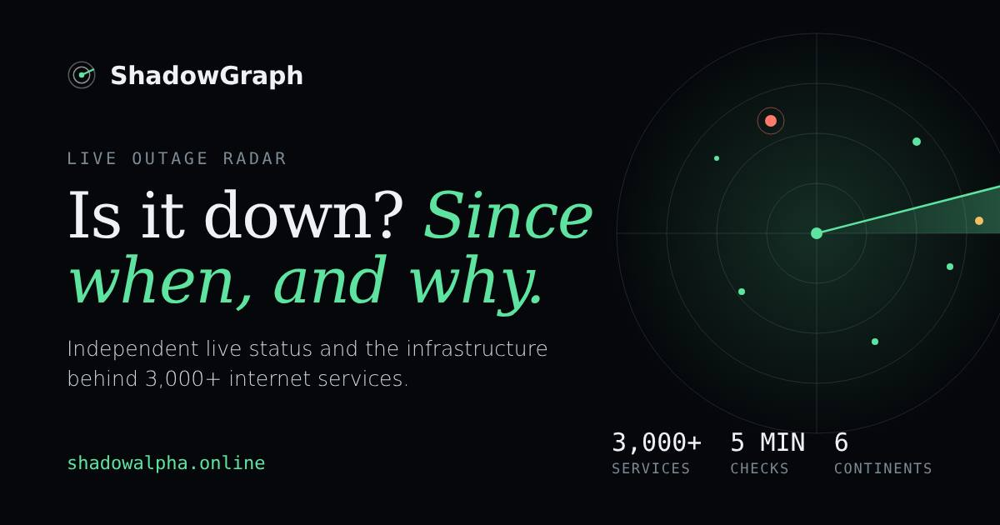

# ShadowGraph API



**Is it down, since when, and why?** Independent live status for about 3,200 internet services (APIs, SaaS, banks, the most-visited websites, cloud regions), checked every 5 minutes, re-checked from six continents, with the infrastructure each service runs on: hosting provider, cloud region, CDN, DNS and email.

No sign-up and no API key for the status, search and research endpoints. AI agents can connect over **MCP** or **A2A**.

- Website: https://shadowalpha.online
- Is it down? (EN): https://shadowalpha.online/is-it-down, (DE): https://shadowalpha.online/de/ist-es-down
- Interactive API reference: https://shadowalpha.online/docs
- OpenAPI 3.1: [`spec/openapi.json`](spec/openapi.json) (live: https://shadowalpha.online/openapi.json)

This repository holds the public specification, connection guides and working examples. The ShadowGraph service itself is closed source.

## Quick start

```bash
# 1. find a service (returns slug + live state)
curl -s "https://shadowalpha.online/_api/search?q=stripe&quick=1"

# 2. is it down right now?
curl -s "https://shadowalpha.online/_api/status/page?slug=stripe-api"

# 3. down everywhere or only in some regions?
curl -s "https://shadowalpha.online/_api/radar/global" | jq '.regionalOutages'
```

The status page response, shortened:

```json
{
  "slug": "stripe-api",
  "kind": "service",
  "name": "Stripe API",
  "checkedAt": "2026-10-14T17:06:40.539Z",
  "rows": [
    { "name": "Stripe API", "state": "up", "since": null, "uptime24h": 1,
      "hostingProvider": "Amazon Web Services", "dnsProvider": "AWS Route 53" }
  ],
  "incidents": [],
  "lastIssue": null,
  "issues30d": 0
}
```

`state` is `up` (answered the last check with HTTP < 500), `degraded` (failed the last check only), `down` (failed two checks in a row) or `unknown`. `since` is the start of the current failing streak.

## Endpoints at a glance

| Endpoint | What you get |
|---|---|
| `GET /_api/status/page?slug=` | One service, brand or provider: live state, failing since, last outage, infrastructure, what fails together |
| `GET /_api/search?q=` | Services, providers, cloud regions, incidents, SEC filers and AI agents for a name or domain |
| `GET /_api/radar/status` | The full live radar (all services, open incidents, 24 h timeline), about 90 KB gzipped |
| `GET /_api/radar/global` | Worldwide re-checks from six continents, regional outages |
| `GET /_api/radar/outlook` | Early warnings, TLS certificate and domain expiry |
| `GET /_api/upstream/signals` | Shared-provider signals from official status pages |
| `POST /_api/vendors/scan_start` | Infrastructure scan of up to 300 vendor domains (DORA third-party register) |
| `GET /_api/research/dataset?table=` | Open measurement data as CSV, CC BY 4.0 |

All 33 operations with schemas and examples: [`spec/openapi.json`](spec/openapi.json) or https://shadowalpha.online/docs.

Please poll at most once per minute per endpoint; the data changes every 5 minutes and responses are cached for 20 s to 5 min.

## For AI agents

### MCP

Streamable HTTP endpoint `https://shadowalpha.online/_api/mcp`, listed in the official MCP Registry as `online.shadowalpha/shadowgraph`.

```bash
claude mcp add --transport http shadowgraph https://shadowalpha.online/_api/mcp
```

Cursor, VS Code, Claude Desktop and SDK setup: [`docs/mcp.md`](docs/mcp.md).

### A2A

Agent card: [`spec/agent-card.json`](spec/agent-card.json) (live at `/.well-known/agent-card.json`), JSON-RPC endpoint `https://shadowalpha.online/_api/a2a`. See [`docs/a2a.md`](docs/a2a.md).

### Paid intelligence

Free tools cover factual lookups. Deeper market and supply-chain intelligence costs $0.50 to $5.00 per call and is paid per request with the open Machine Payments Protocol (HTTP 402, Stripe), without an account. See [`docs/payments.md`](docs/payments.md).

## Examples

| Example | Language | What it does |
|---|---|---|
| [`examples/curl/is-it-down.sh`](examples/curl/is-it-down.sh) | Bash | One-line answer for any service name |
| [`examples/python/is_it_down.py`](examples/python/is_it_down.py) | Python | Same, with the infrastructure behind the service |
| [`examples/python/slack_alert.py`](examples/python/slack_alert.py) | Python | Posts to Slack when one of your dependencies goes down or recovers |
| [`examples/javascript/is-it-down.mjs`](examples/javascript/is-it-down.mjs) | Node.js | Status check with `fetch`, no dependencies |
| [`examples/javascript/mcp-client.mjs`](examples/javascript/mcp-client.mjs) | Node.js | Lists the MCP tools and calls a free one |
| [`examples/python/mcp_client.py`](examples/python/mcp_client.py) | Python | Same with the official Python SDK |
| [`examples/github-actions/dependency-check.yml`](examples/github-actions/dependency-check.yml) | GitHub Actions | Warns in CI when a provider you deploy to is down |

## Data and methodology

Measurements come from one node in AWS us-east-1 every 5 minutes plus six worldwide probes every 30 minutes. Infrastructure is mapped from public DNS, network ownership and the cloud providers' published IP ranges. Methods, limits and retired rules: https://shadowalpha.online/research/methods.

A service can be down for you and up for us, or the other way round. Outputs labelled inferred or statistical are hypotheses, not proof.

## License

Code and documentation in this repository: MIT (see [`LICENSE`](LICENSE)). Open data tables from the API: CC BY 4.0, cite as "ShadowGraph Open Measurement Dataset, shadowalpha.online".
